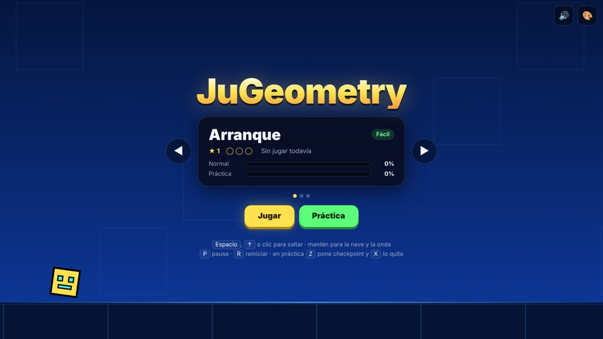
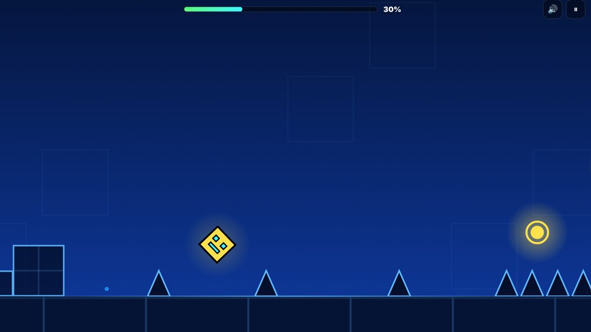
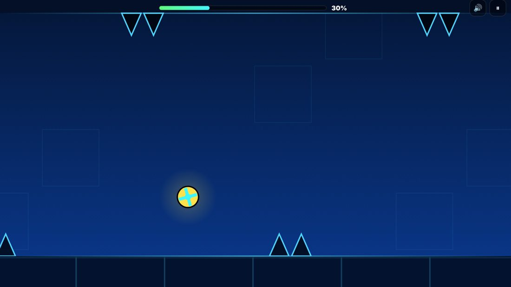
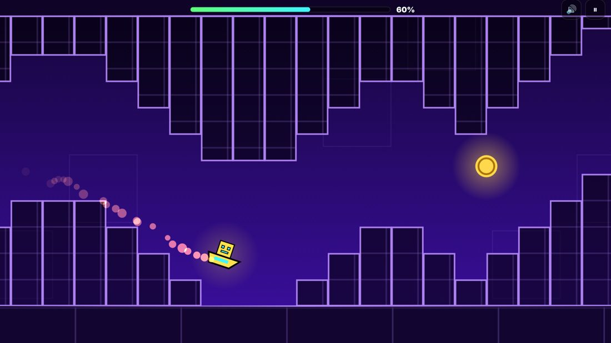
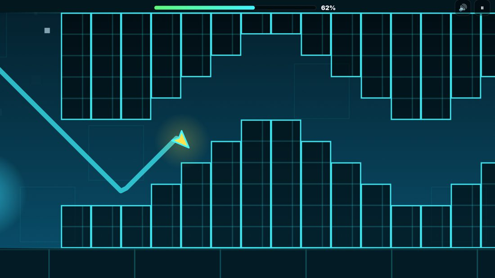

# JuGeometry

Juego de ritmo y salto que corre en el navegador. Avanzas solo, al ritmo de la música, y tú decides cuándo saltar. Un error y empiezas de nuevo.

**[Jugar aquí](https://said1ojeda.github.io/JuGeometry/)**



## Modos

Durante el nivel, los portales te van cambiando de modo. Cada uno se controla distinto:

| | Modo | Cómo se controla |
|---|---|---|
| ■ | **Cubo** | Toca para saltar. Si lo mantienes, salta cada vez que cae. |
| ▲ | **Nave** | Mantén para subir y suelta para bajar. |
| ● | **Bola** | Cada toque invierte la gravedad, del suelo al techo y de regreso. |
| ◆ | **Onda** | Mantén para subir en diagonal y suelta para bajar. Choca con cualquier bloque y pierdes. |

<p>
  
  
  
  
</p>

## Lo que te encuentras en los niveles

- **Orbes**: se activan si tocas mientras pasas encima de ellos. El amarillo es un salto normal, el rosado un salto corto y el azul invierte la gravedad.
- **Pads**: te lanzan solos al pisarlos. El azul te manda al techo.
- **Portales de gravedad**: el azul es gravedad normal y el amarillo la invierte.
- **Portales de velocidad**: las flechas dicen qué tan rápido vas, de 1 a 4.
- **Monedas**: hay 3 escondidas por nivel. Solo se guardan si terminas el nivel en modo normal.

## Niveles

| Nivel | Dificultad | BPM | Qué tiene |
|---|---|---|---|
| **Arranque** | Fácil | 120 | Cubo, pads, orbes y una parte de nave tranquila |
| **Pulso Neón** | Normal | 140 | Gravedad invertida, bola, orbes azules y nave más rápida |
| **Corriente** | Difícil | 160 | Cambios de modo seguidos, onda a velocidad máxima y de todo un poco |

Los obstáculos están puestos sobre los tiempos de la canción, por eso los saltos caen con el ritmo.

## Controles

| Acción | Teclado | Cel o mouse |
|---|---|---|
| Saltar / subir | `Espacio`, `↑` o `W` | Tocar la pantalla |
| Pausa | `P` o `Esc` | Botón ⏸ |
| Reiniciar | `R` | Desde la pausa |
| Poner checkpoint (práctica) | `Z` | Botón ◆ Checkpoint |
| Quitar checkpoint | `X` | Botón ✕ Quitar |
| Sonido | `M` | Botón 🔊 |

## Modo práctica

Pones checkpoints donde quieras y, al morir, apareces en el último en vez de volver al inicio. La música también arranca desde ese punto. Tu avance en práctica se guarda aparte del normal.

## Tu icono

Desde el botón 🎨 del menú escoges el color principal, el secundario y la cara del cubo. Se guarda en el navegador, junto con tu mejor porcentaje, las monedas y los intentos de cada nivel.

## Cómo está hecho

TypeScript en modo estricto con `<canvas>`, sin librerías ni archivos de audio. El código se escribe en `src/` y se compila a `js/`, que es lo que carga la página.

```
index.html         pantallas y estilos
src/tipos.d.ts     tipos del estado, los objetos del nivel y las canciones
src/motor.ts       física, choques y el armado de niveles
src/niveles.ts     los tres niveles, escritos por beats
src/musica.ts      la música, generada con Web Audio
src/juego.ts       dibujo, controles, menús y modo práctica
js/                lo compilado, no se edita a mano
```

- **Física a paso fijo** (240 veces por segundo). El juego se comporta igual en una compu lenta que en una rápida, y el mismo intento siempre da el mismo resultado.
- **Movimiento suave en cualquier monitor.** El dibujo va entre el paso de física anterior y el actual, así la cámara avanza parejo en pantallas de 60, 120 o 144 Hz aunque a un cuadro le toquen 3 pasos y al siguiente 5.
- **Tipos para todo.** Cada objeto del nivel es un tipo distinto, entonces el compilador avisa si un portal se usa como bloque o si un orbe trae un color que no existe.
- **Niveles por beats.** Cada obstáculo se pone en un tiempo de la canción y el motor lo convierte en posición según la velocidad. Si un portal cambia la velocidad, lo que viene después se sigue acomodando al ritmo.
- **La música se arma en vivo**: bombo, caja, hi-hat, bajo, arpegio y acordes. Cada canción tiene su escala, sus acordes y partes más intensas donde el nivel se pone difícil.
- **Hitbox justo.** Los picos tienen una caja más chica que su dibujo y los bloques solo matan si te metes de lado. Si caes encima, aterrizas.
- **Toques que no se pierden.** Si tocas un poquito antes de caer al suelo, el cubo salta en cuanto aterriza, sin tener que atinarle al momento exacto.
- **Niveles revisados con un bot.** Busca todas las formas de pasar cada nivel y mide el margen de tiempo de cada salto. Se ajustaron los niveles hasta que ningún salto obligatorio tuviera un margen injusto: al menos 130 ms en Fácil, 105 en Normal y 80 en Difícil. También se confirmó que cada moneda se puede agarrar y que ningún nivel se pasa sin tocar nada o manteniendo todo el tiempo.

## Correrlo en tu compu

Para jugar, descarga el repo y abre `index.html`. No necesita instalar nada porque `js/` ya viene compilado.

Para modificarlo necesitas [Node.js](https://nodejs.org):

```
npm install
npm run watch
```

`watch` recompila cada vez que guardas un archivo de `src/`. Con `npm run check` solo revisa los tipos sin generar nada.

## Licencia

MIT. Ver [LICENSE](LICENSE).
